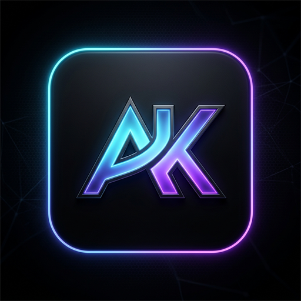
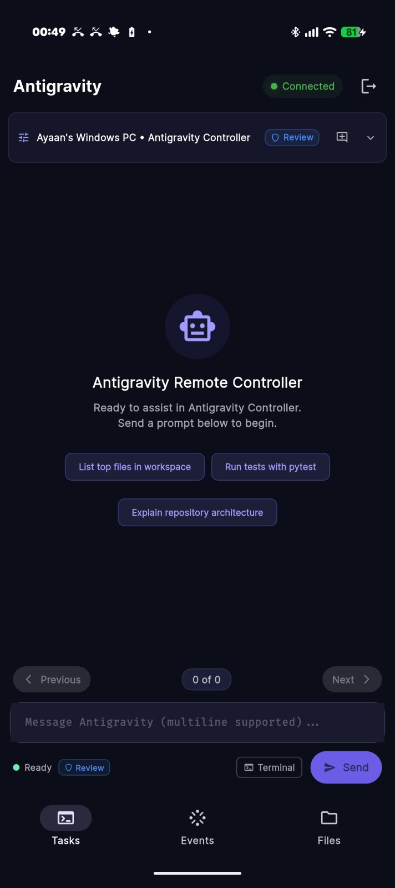
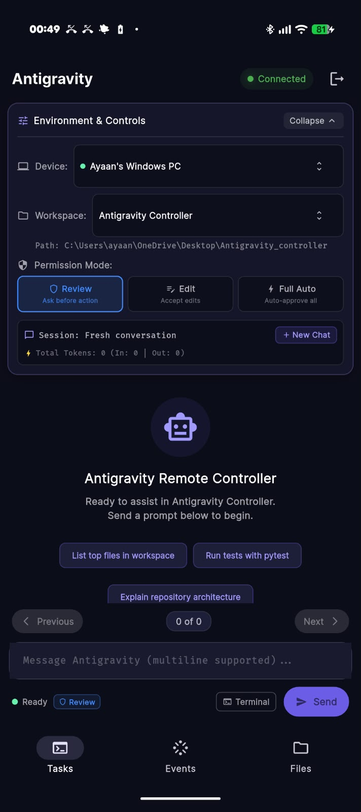
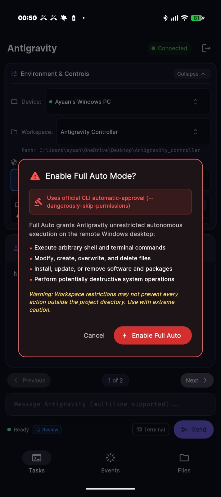
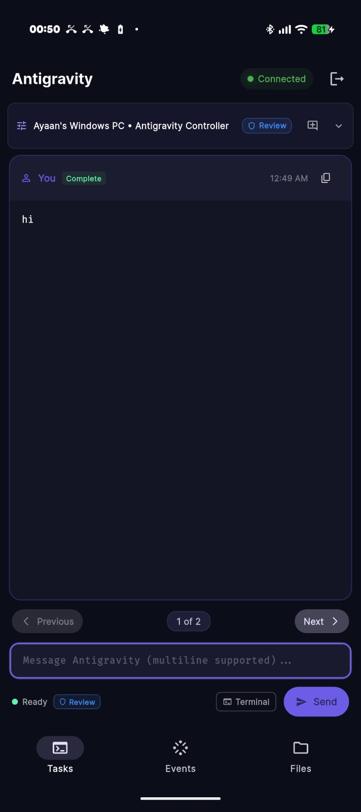
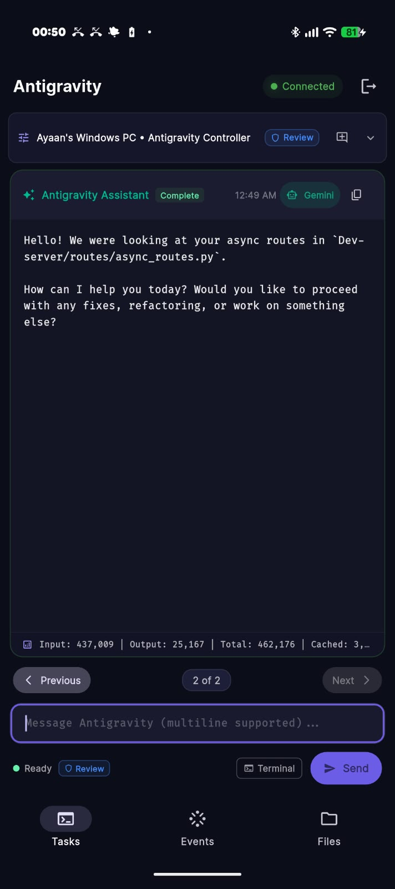
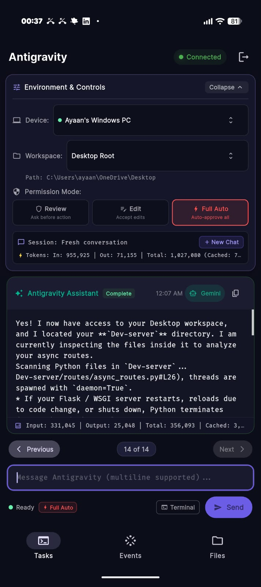
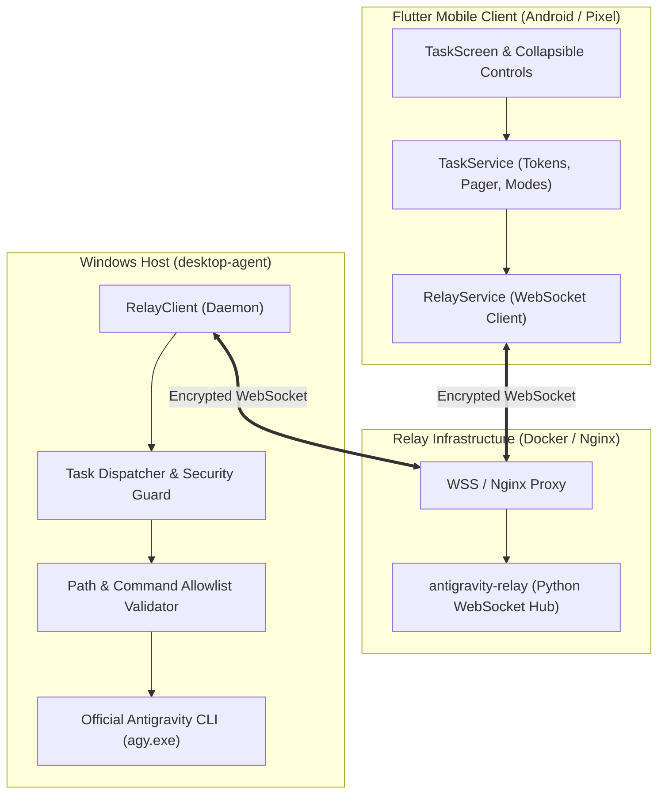

# 🚀 Antigravity Remote Controller

<div align="center">



### Autonomous Remote AI Engineering for Windows Desktop & Pixel Mobile
**Live Streaming • Multi-Tier Permissions • Token Analytics • Encrypted Relay**

[](#)
[](#)
[](#)
[](#)
[-00E676)](#)

</div>

---

## 📖 Overview

**Antigravity Remote Controller** transforms your mobile device (including Google Pixel phones) into a secure, responsive remote command center for the official **Antigravity CLI** (`agy.exe`) running on your Windows PC. 

Whether reviewing code refactors from anywhere, inspecting complex repository hierarchies, or unleashing **Full Auto mode** to autonomously execute commands and apply diffs across workspaces, this project provides a unified bridge through an encrypted WebSocket relay.

---

## 📸 Visual Showcase

<div align="center">

| 1. Focused Chat View | 2. Environment & Controls | 3. Full Auto Security Modal |
| :---: | :---: | :---: |
|  |  |  |
| *Clean collapsed navigation maximizing chat space, suggested prompts, and persistent status chip.* | *Collapsible panel with Device switching, Workspace targeting, Permission mode picker, and session stats.* | *Explicit confirmation dialog explaining security implications before enabling `--dangerously-skip-permissions`.* |

| 4. User Prompt Card | 5. Live Streaming Response | 6. Full Auto In Action |
| :---: | :---: | :---: |
|  |  |  |
| *Card-based message pager (`1 of 2`) with timestamp and instant copy-to-clipboard.* | *Real-time NDJSON text streaming, Gemini status pill, and per-message token usage breakdown.* | *Autonomous tool & command execution with over 1M+ cumulative tokens and active status pill.* |

</div>

---

## ⚡ Key Features

### 🛡️ 1. Multi-Tier Permission Engine
Easily switch between three execution safety levels directly from the mobile UI:

- **Review (`request-review`)** — *Default safe mode.* Prompts for user verification whenever high-impact actions occur. In headless execution, actions requiring interactive confirmation fail gracefully with actionable explanations.
- **Edit (`accept-edits`)** — Automatically approves file changes and code edits without interactive prompting (`--mode accept-edits`).
- **Full Auto (`--dangerously-skip-permissions`)** — Harnesses the official Antigravity CLI automatic-approval engine (`permission_mode: always-proceed`). Autonomously executes shell commands, runs test suites, navigates files, and commits updates without interactive blocks.
  > **⚠️ Security Guardrail:** Activating Full Auto requires explicit user confirmation via an interactive safety warning dialog detailing potential file modifications and shell execution risks.

### 📱 2. Redesigned Mobile UX (Pixel & Android)
- **Collapsible Environment Bar**: Device selector, workspace directory dropdown, custom Windows path dialog, permission chips, and session statistics collapse seamlessly to maximize vertical space.
- **Persistent Status Indicators**: Connection status and active permission mode (`Review`, `Edit`, `Full Auto`) remain visible at all times.
- **CLI Mode Mismatch Detection**: Automatically detects and visually flags when the effective CLI mode differs from the requested mode.
- **Independent Card Scrolling & Navigation**: Long responses can be inspected independently with dedicated previous/next controls, token statistics, and copy buttons.
- **Custom Cyber "AK" App Icon**: Custom adaptive icon optimized for Android and Google Pixel launchers with deep obsidian background and glowing neon accents.

### 📊 3. Live Token Analytics & Streaming
- **Per-Message Breakdown**: Displays exact `Input`, `Output`, `Total`, and `Cached` token consumption per assistant response.
- **Session Cumulative Totals**: Tracks total tokens spent across entire multi-turn conversations.
- **Real-Time NDJSON Streaming**: Zero-lag streaming of response deltas over WebSocket via `asyncio.create_subprocess_exec`.

### 🔒 4. Bulletproof Security & Git Privacy
- **Multi-Tier `.gitignore` Protection**: Excludes all `.env`, `.env.*`, `*.pem`, `*.key`, `*.keystore`, `*.jks`, and audit logs from version control across all subprojects.
- **Pre-Flight Path Verification**: Validates that workspace paths exist and are accessible on the Windows host before CLI invocation.
- **Audit Logging**: Structured JSON audit trail of every terminal action, workspace access, and permission transition.

---

## 🏗️ Architecture



---

## 📂 Project Structure

```text
Antigravity_controller/
├── docs/
│   └── screenshots/              # High-resolution screenshots & app icon
├── antigravity_remote_agent_bundle/
│   └── antigravity_remote_agent/
│       ├── antigravity-relay/    # Dockerized Relay server (WebSocket hub)
│       │   ├── app.py
│       │   ├── compose.yaml
│       │   ├── Dockerfile
│       │   ├── requirements.txt
│       │   └── .env.example
│       ├── desktop-agent/        # Windows Desktop Agent (Python)
│       │   ├── app/
│       │   │   ├── adapters/     # agy.exe CLI adapter with streaming
│       │   │   ├── commands.py   # Terminal execution & allowlist
│       │   │   ├── config.py     # Environment loader
│       │   │   ├── main.py       # Async dispatcher & task lifecycle
│       │   │   ├── relay.py      # Secure WebSocket client
│       │   │   ├── security.py   # Path validation, permission rules & audit
│       │   │   └── workspace.py  # File directory navigation
│       │   ├── tests/            # Pytest test suite (56 tests)
│       │   └── .env.example
│       ├── flutter-mobile/       # Mobile client (Flutter / Android)
│       │   ├── android/          # Native Android configuration & AK icons
│       │   ├── lib/              # UI screens, widgets, models, services
│       │   ├── test/             # Flutter unit & widget tests (31 tests)
│       │   └── .env.example
│       ├── .env.example          # Master environment template
│       └── .gitignore            # Multi-tier secret & credential filter
├── .gitignore                    # Root repository security filter
└── README.md                     # Documentation
```

---

## 🚀 Getting Started

### 1. Prerequisites
- **Windows PC**: Python 3.11+, Official Antigravity CLI (`%LOCALAPPDATA%\agy\bin\agy.exe`)
- **Server**: Docker & Docker Compose (or cloud VM with Nginx SSL reverse proxy)
- **Mobile Device**: Android phone (e.g. Google Pixel) or Android Emulator with Flutter 3.2+

---

### 2. Deploying the Relay Server

Navigate to `antigravity_remote_agent_bundle/antigravity_remote_agent/antigravity-relay/`:

```bash
# 1. Copy environment template
cp .env.example .env

# 2. Configure a strong RELAY_TOKEN in .env
# RELAY_TOKEN=your-random-secure-secret-here

# 3. Launch container with Docker Compose
docker compose up -d --build
```

Nginx configuration snippet for WebSocket forwarding:
```nginx
location /ws/ {
    proxy_pass http://127.0.0.1:8765;
    proxy_http_version 1.1;
    proxy_set_header Upgrade $http_upgrade;
    proxy_set_header Connection "Upgrade";
    proxy_set_header Host $host;
    proxy_read_timeout 86400s;
    proxy_send_timeout 86400s;
}
```

---

### 3. Setting Up the Windows Desktop Agent

Navigate to `antigravity_remote_agent_bundle/antigravity_remote_agent/desktop-agent/`:

```powershell
# 1. Create and activate virtual environment
python -m venv .venv
.venv\Scripts\activate

# 2. Install dependencies
pip install -r requirements.txt

# 3. Configure .env
cp .env.example .env
# Set RELAY_URL, ENROLLMENT_TOKEN, and WORKSPACE_ROOTS in .env

# 4. Run tests to verify setup
python -m pytest -v tests/

# 5. Start the Desktop Agent
python -m app.main
```

---

### 4. Running the Flutter Mobile App

Navigate to `antigravity_remote_agent_bundle/antigravity_remote_agent/flutter-mobile/`:

```bash
# 1. Copy environment template
cp .env.example .env
# Set RELAY_URL, RELAY_WS_URL, and credentials in .env

# 2. Fetch packages
flutter pub get

# 3. Verify tests
flutter test

# 4. Run on your connected Pixel phone
flutter run
```

---

## 🧪 Testing & Verification

All test suites pass across Python and Dart components:

```bash
# Desktop Agent Pytest (56 tests)
pytest -v tests/
# Result: 56 passed in 0.78s (100%)

# Flutter Analysis
flutter analyze
# Result: No issues found!

# Flutter Test Suite (31 tests)
flutter test
# Result: All 31 tests passed!
```

---

## 🔒 Security Best Practices

1. **Keep `.env` Private**: Never push `.env` files to git. Pre-configured `.gitignore` files automatically block them.
2. **Exercise Full Auto with Discretion**: Full Auto executes operations without interactive confirmation prompts. Always verify the workspace target before enabling.
3. **Workspace Path Containment**: The desktop agent strictly validates all paths against allowed `WORKSPACE_ROOTS` to prevent directory traversal outside configured projects.
